

# FW Global

**The company website and private operations console for FW Global LLC: a fast single-page marketing site, a product catalogue driven by a live registry, and an authenticated admin area for editing products, tracking builds and reading app analytics.**

**[Live website: fwglobal.co](https://fwglobal.co)**

React 18 · TypeScript · Vite · Tailwind CSS · Netlify Edge Functions · Cloudflare R2

<table>
  <tr>
    <td>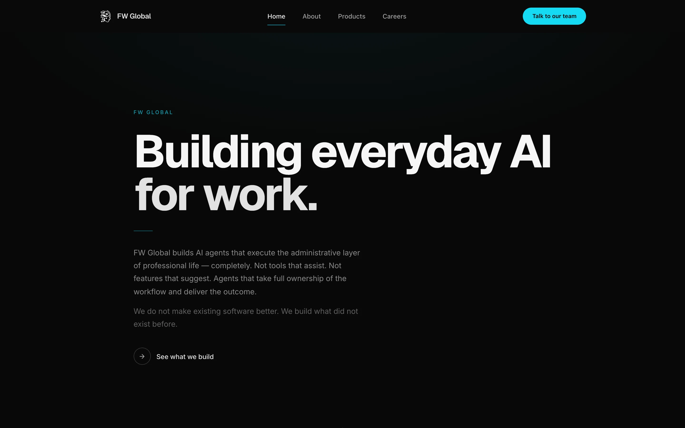</td>
    <td>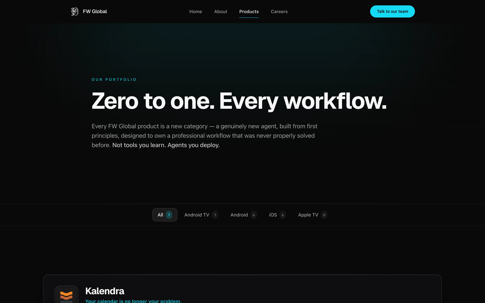</td>
  </tr>
</table>
Real captures of the live site at 1440 px wide.

---

## Live Website

The public site is live at **[https://fwglobal.co](https://fwglobal.co)**. It presents FW Global LLC, its positioning as an AI applications company, its Kalendra scheduling product, and a catalogue of mobile apps with store badges and per-app privacy policies. The admin area is private and is not shown here.

## Product at a Glance

| | |
|---|---|
| **What it is** | Company website plus a private admin console, shipped as one React single-page app |
| **Public pages** | Home, About, Products, Kalendra, Careers, Contact, Privacy, Terms, per-app privacy policies, 404 |
| **Catalogue** | Products page merges a built-in fallback list with a live registry served from object storage; filterable by platform |
| **Admin (private)** | Password-gated: product editor, build and QA tracker, repository of app metadata, analytics dashboards |
| **Backend** | No application server. Seven Netlify Edge Functions front an S3-compatible bucket |
| **Hosting** | Netlify static hosting with SPA fallback, security headers and immutable asset caching |
| **Code size** | About 38,700 lines of TypeScript and TSX across the site and the admin modules |
| **Verified build** | Production build completes; about 95 emitted assets, main bundle about 195 kB gzipped |

## Screenshots

<table>
  <tr>
    <td align="center">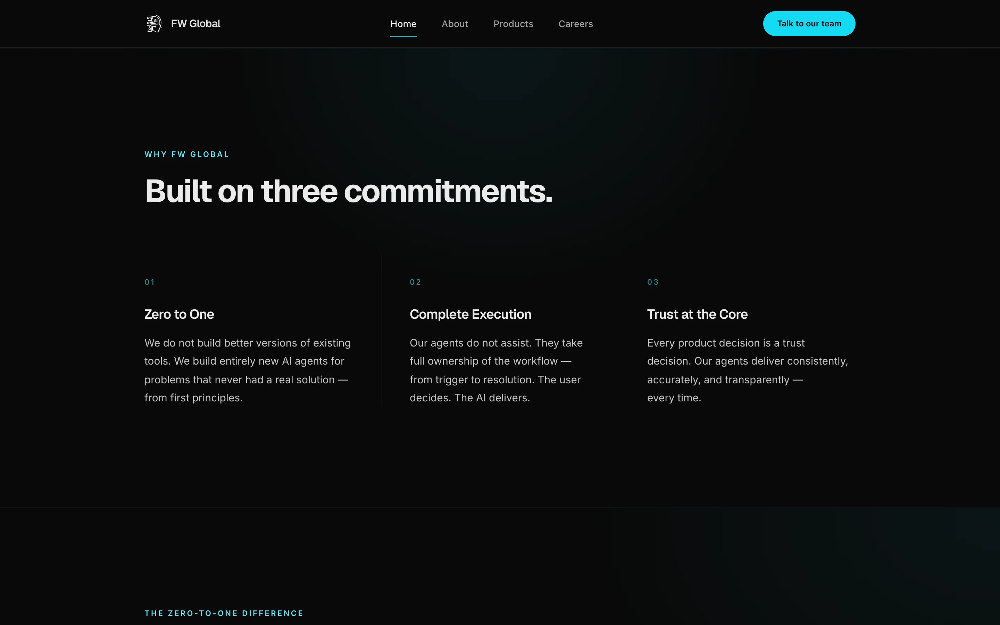 <b>Home</b> Positioning and three commitments</td>
    <td align="center">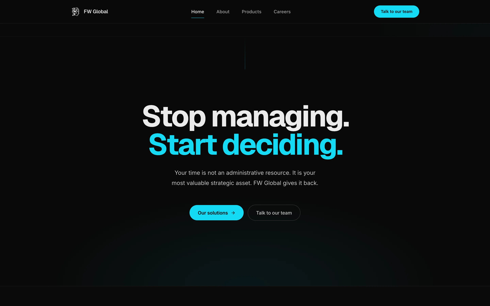 <b>Home</b> Closing call to action</td>
  </tr>
  <tr>
    <td align="center">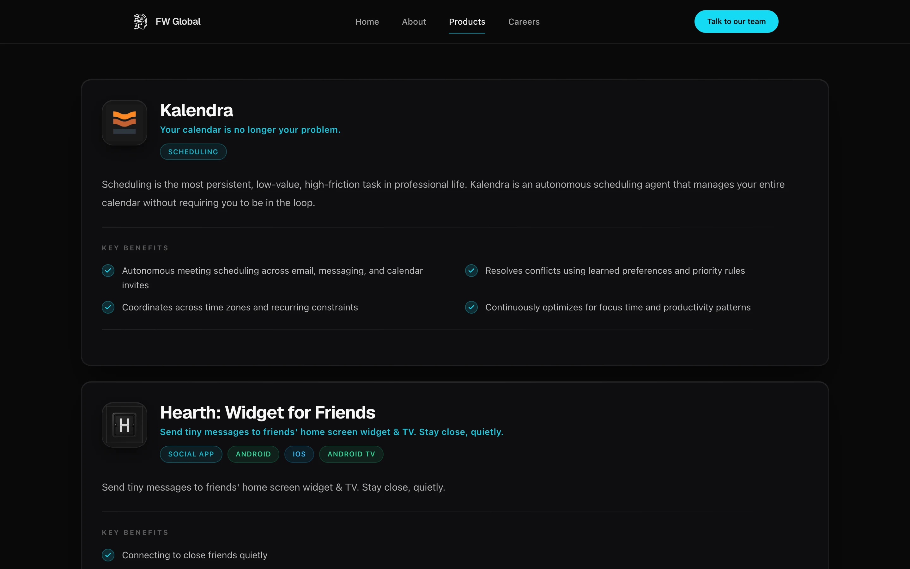 <b>Products</b> Catalogue cards with benefits</td>
    <td align="center">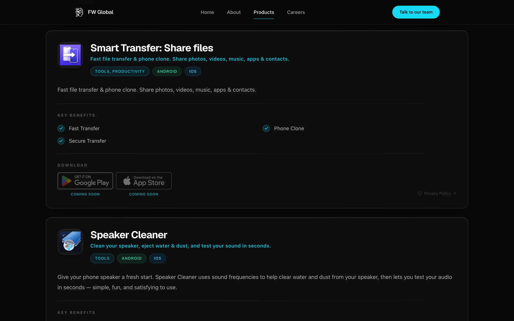 <b>Products</b> Store badges, coming-soon state, privacy link</td>
  </tr>
  <tr>
    <td align="center">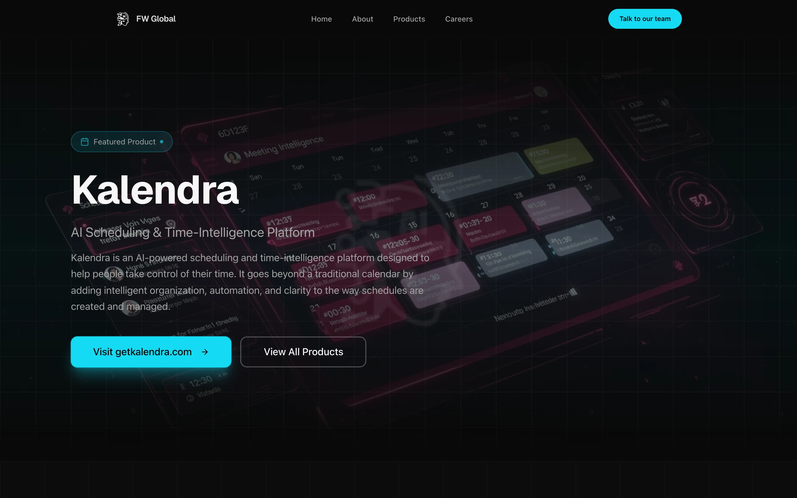 <b>Kalendra</b> Featured product page</td>
    <td align="center">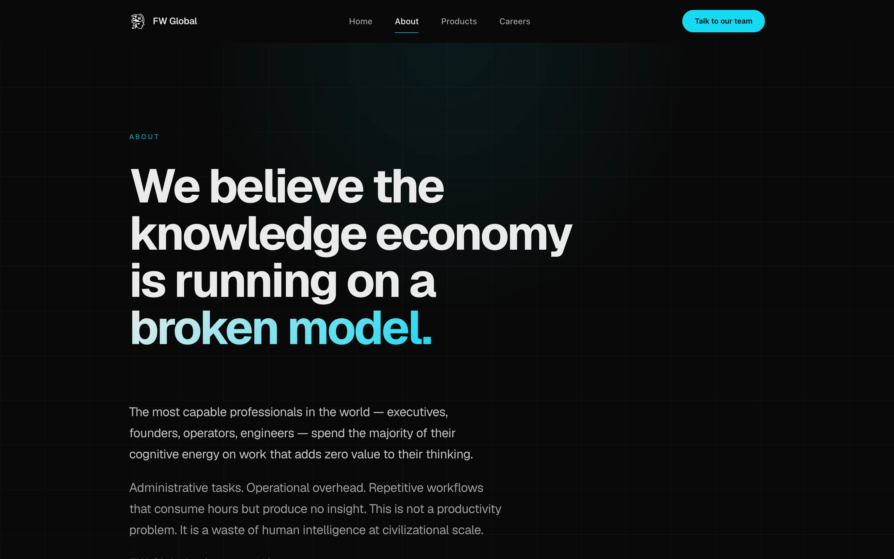 <b>About</b> Company story</td>
  </tr>
  <tr>
    <td align="center">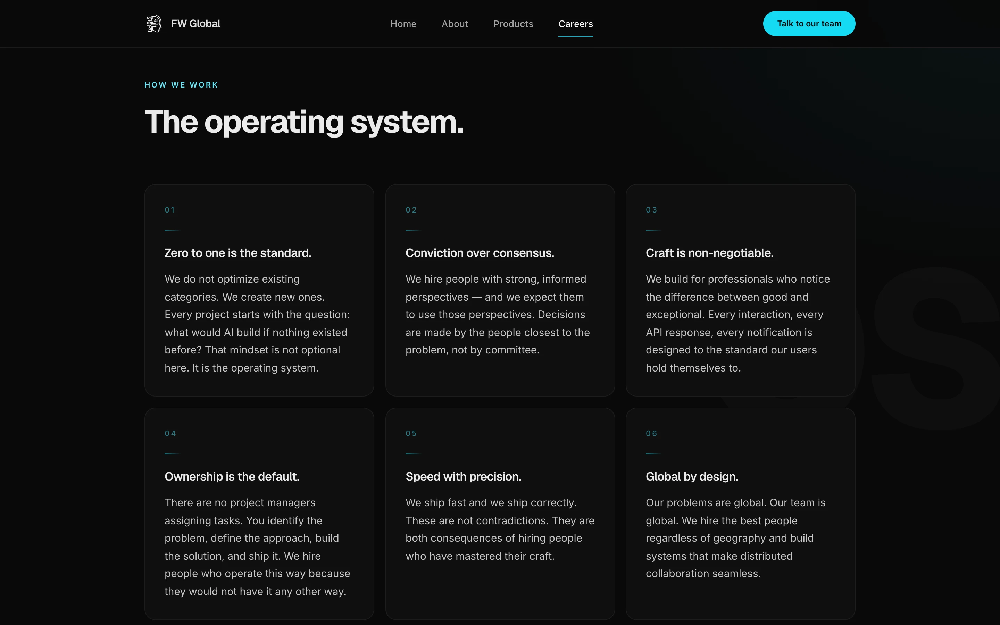 <b>Careers</b> Operating principles grid</td>
    <td align="center">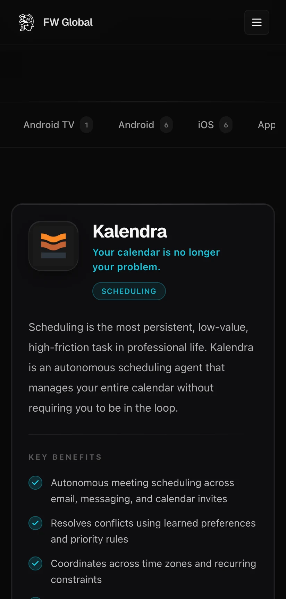 <b>Mobile</b> Products at 412 px, scrollable filter tabs</td>
  </tr>
</table>

## Key Features

- **Registry-driven catalogue.** The Products page renders a built-in fallback list immediately, then merges in apps from `/api/apps`. An app appears only when it is enabled, complete (name, tagline, descriptions, category, icon, benefits, store links, privacy policy) and visible to this site.
- **Per-app privacy policies.** `/privacy/:appId` resolves by bundle id or a custom slug and renders the policy stored in the registry.
- **Product editor.** The admin editor changes products, icons, store links, rich-text policies (Tiptap) and the ad-verification file without a redeploy.
- **Build and QA tracker.** A dashboard module for builds, QA sign-off, release history and per-app metadata, persisted to the bucket.
- **Analytics dashboards.** Thirteen lazy-loaded per-app pages plus overview, monetisation, geography, stability and app-intelligence views, fed by CSV and JSON exports parsed in a web worker and cached in IndexedDB.
- **Contact form.** Form with native required-field and email validation that sends through a hosted email service; the service configuration is supplied at build time, and the UI falls back to a direct-email message if it is missing or the send fails.
- **SEO and sharing.** Per-page titles and descriptions, canonical link, Open Graph and Twitter cards, Organization JSON-LD, sitemap, robots file and web manifest.

## Architecture

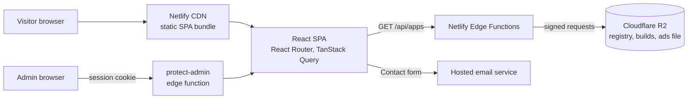

Details: [docs/ARCHITECTURE.md](docs/ARCHITECTURE.md).

## Technology Stack

| Layer | Technology |
|---|---|
| UI | React 18, TypeScript 5, shadcn/ui on Radix primitives, Tailwind CSS 3 |
| Routing and data | React Router 6, TanStack Query 5, React Hook Form, Zod |
| Motion | Framer Motion with a shared motion-token module, CSS reveal animations |
| Admin | Recharts, TanStack Table, Tiptap, PapaParse in a web worker, IndexedDB via `idb` |
| SEO | react-helmet-async, static JSON-LD, sitemap, robots, manifest |
| Backend | Netlify Edge Functions (Deno) with hand-written AWS SigV4 signing for R2 |
| Storage | Cloudflare R2 (S3-compatible) |
| Build and hosting | Vite 5 with SWC, Netlify (Node 22), ESLint 9 |

## Engineering Highlights

### Dependency-free signed storage access from the edge
- **Problem:** the admin tools need durable, shared storage but the site has no server.
- **Approach:** edge functions sign S3-compatible requests to R2 with a small SigV4 implementation built on Web Crypto, factored into one shared module.
- **Outcome:** one storage client reused by the registry, builds, layout and ad-file endpoints, with no SDK in the edge bundle.

### One registry, two storefronts
- **Problem:** two company sites show overlapping app lists.
- **Approach:** each registry record carries a visibility field (`futureWatch`, `fwGlobal` or `both`) and a single completeness rule decides whether it is live or "coming soon".
- **Outcome:** the same record can be scoped to one site or both, and an incomplete record can never leak onto a public page.

### Admin gate that is correct at the path level
- **Problem:** a naive prefix check would gate unrelated paths.
- **Approach:** the gate matches exactly `/admin` or `/admin/*`, compares a deterministic HMAC session token in constant time, sets an `HttpOnly`, `SameSite=Strict`, `Secure` cookie, and restricts post-login redirects to in-app admin paths.
- **Outcome:** no open redirect, no timing-comparison shortcut, and authenticated responses are sent `no-store, private`.

More: [docs/ENGINEERING_CHALLENGES.md](docs/ENGINEERING_CHALLENGES.md).

## Responsive and Design Considerations

Verified on the live site:

- At 412 px wide the page has no horizontal overflow (document width equals viewport width).
- The desktop navigation collapses to a menu button and a full-width call to action on mobile.
- Platform filter tabs scroll horizontally on small screens rather than wrapping.
- Display type uses Geist and Inter; the palette is a near-black base with a single cyan accent.
- A `prefers-reduced-motion` rule exists in the stylesheet.

## Technical Challenges

Page-level code splitting for a large admin surface, keeping dashboard parsing off the main thread, and designing a small auth gate without a server are written up in [docs/ENGINEERING_CHALLENGES.md](docs/ENGINEERING_CHALLENGES.md).

## Platform and Status

| | |
|---|---|
| **Status** | Live in production |
| **Platform** | Web (responsive, evergreen browsers) |
| **Hosting** | Netlify |
| **Public site** | [fwglobal.co](https://fwglobal.co) |

## Documentation

| Read | For |
|---|---|
| [Product overview](docs/PRODUCT_OVERVIEW.md) | Pages, catalogue and admin areas |
| [Technical case study](docs/TECHNICAL_CASE_STUDY.md) | End-to-end write-up |
| [Architecture](docs/ARCHITECTURE.md) | Layers, flows and diagrams |
| [Engineering challenges](docs/ENGINEERING_CHALLENGES.md) | Problem, approach, trade-offs, outcome |
| [Privacy and source](docs/PRIVACY_AND_SOURCE.md) | What is and is not published |
| [Rights](RIGHTS.md) | Usage terms |

## Source Code

This repository is a portfolio showcase for a production website. Production source code is maintained privately. See [RIGHTS.md](RIGHTS.md) for usage terms.
