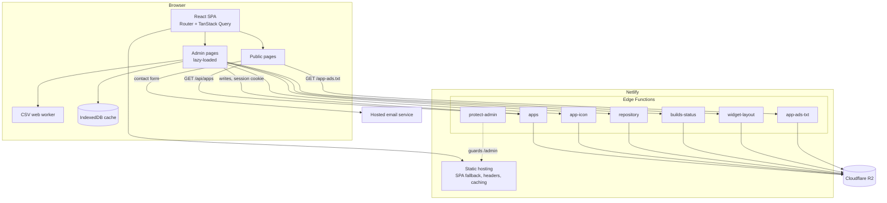
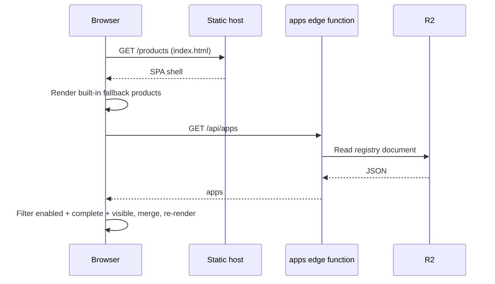
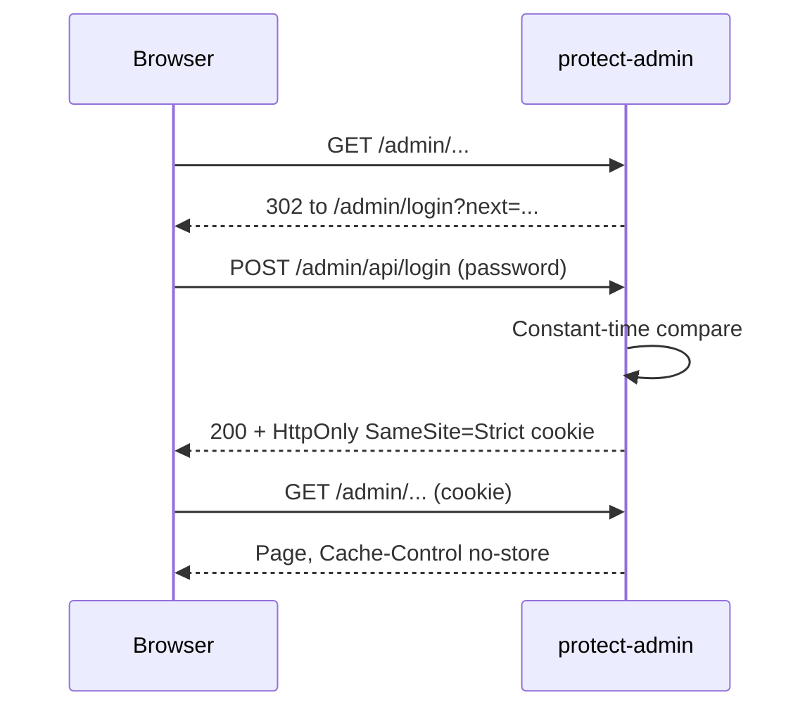

# Architecture

## Overview

## Layers

**Presentation.** Pages and section components under one source tree. Public pages share a layout (navbar, footer). Admin pages share an admin layout with sidebar navigation. The analytics and build-tracker modules live in their own folders and are mounted by path alias.

**Data access.** `useApps()` wraps the registry fetch in TanStack Query. Admin screens use plain `fetch` helpers that send the session cookie. Analytics data is loaded as CSV or JSON, parsed in a web worker and cached in IndexedDB.

**Edge.** Each edge function owns one resource and one URL. Reads that must work for visitors are unauthenticated; writes check the admin session cookie. A shared module holds session helpers; another holds the R2 signing client.

**Storage.** One R2 bucket with key prefixes per concern: product registry, build state documents, ad-verification text and uploaded icons.

## Request flows

### Visitor opens Products

### Admin sign-in

## Failure behaviour

- If the registry call fails, the built-in product list stays on screen.
- If the admin password is not configured, the gate returns 503 instead of opening the area.
- If storage credentials are missing, storage-backed endpoints report that and fall back where a static default exists (for example the ad-verification file).
- A React error boundary prevents a render error from blanking the whole app.
